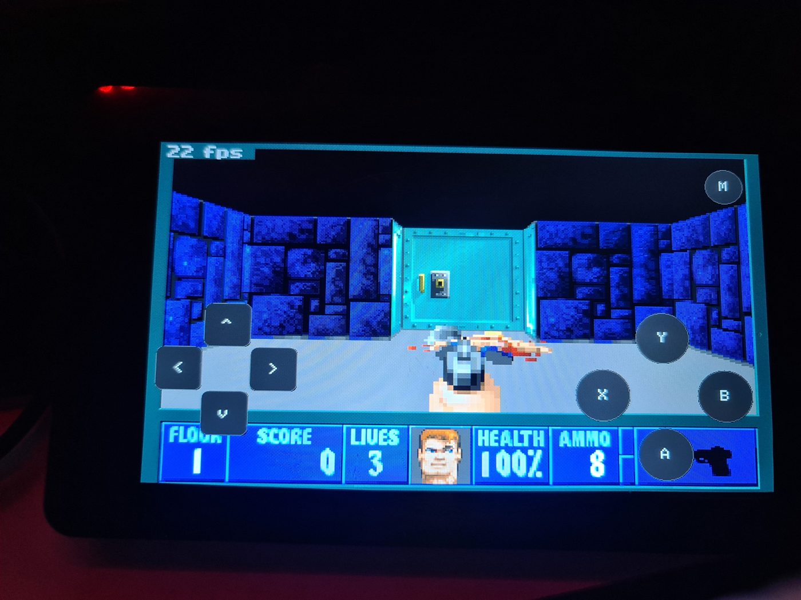
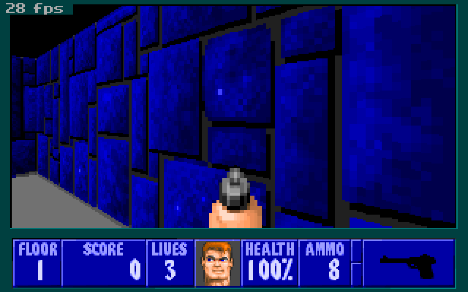
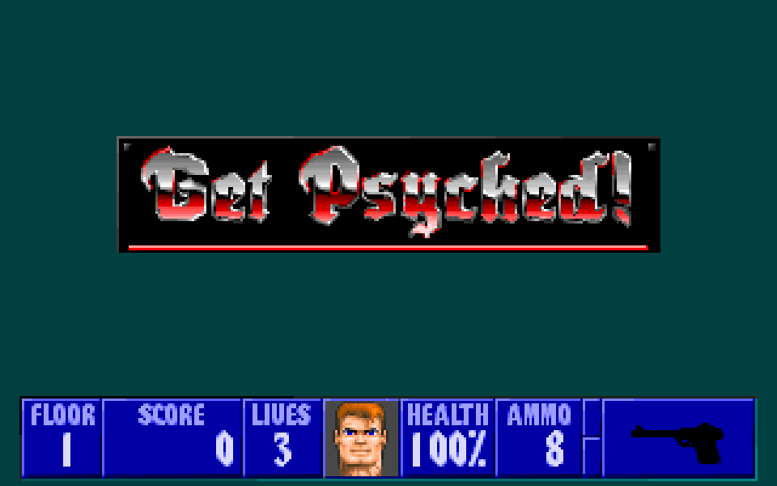

# ESP32-S3 Wolfenstein 3D

Wolfenstein 3D running full screen on the **Waveshare ESP32-S3-Touch-LCD-7** (800x480 RGB panel, capacitive touch), controlled with an on-screen gamepad. Built on a modified [Wolf4SDL](https://github.com/fabiangreffrath/wolf4sdl) with PlatformIO and the Arduino framework.

[Türkçe README](README.tr.md)



*An early build, still at 22 fps. The current build runs about 33 fps while moving and about 70 fps standing still.*

## Screenshots

| In game | Level loading |
|---|---|
|  |  |

*Captured from the game's 320x200 frame buffer by the debug build, so the touch overlay is not drawn on them.*

## Features

- Full-screen 800x480 output straight into the RGB framebuffer (zero-copy, no tearing from a back buffer)
- Touch gamepad overlay: D-pad, A / B / X / Y and a menu button, drawn without flicker
- On-screen QWERTY keyboard for save game names and high score names
- Save / load to the SD card
- About 33 fps while moving, about 70 fps standing still (the game's 70 Hz tick cap)
- Debug build that boots straight into a level and logs frame timing over UART

## Hardware

| Part | Notes |
|---|---|
| Board | Waveshare ESP32-S3-Touch-LCD-7 (ESP32-S3, 16 MB flash, 8 MB OPI PSRAM) |
| Display | 800x480 RGB, driven with LovyanGFX |
| Touch | GT911 over I2C |
| Storage | microSD over SPI at 4 MHz (the CS line goes through a CH422G expander) |
| Sound | not wired yet, see the roadmap |

## Build and flash

Install [PlatformIO](https://platformio.org/), then:

```bash
pio run -e esp32s3box -t upload
```

Open the serial log with `pio device monitor -b 115200`. On this board the USB port labelled UART goes through a CH343 bridge, so log output that uses `Serial` is only visible on the native USB port, while `log_e` output appears on the UART port.

### Game data

The game data is **not included** and cannot be redistributed. Copy the files from your own copy of Wolfenstein 3D (the full version, `.WL6`) to the root of a FAT-formatted SD card:

`AUDIOHED.WL6`, `AUDIOT.WL6`, `GAMEMAPS.WL6`, `MAPHEAD.WL6`, `VGADICT.WL6`, `VGAGRAPH.WL6`, `VGAHEAD.WL6`, `VSWAP.WL6`

`sd_card_files/README.txt` has more detail (in Turkish). This build targets the Activision / GOODTIMES release of the full game.

If you own the original game, use your own files. The shareware episode (`.WL1`) is not supported by this build yet and no game files are shipped here.

## Controls

| Button | Game | Menu |
|---|---|---|
| D-pad | move / turn | navigate |
| A | open doors | select |
| B | run | back |
| X | fire | |
| Y | strafe | |
| M | menu | |

## How it works

- **Core 1** runs the game (`wolfTask`). **Core 0** runs the display task and the touch task.
- The game renders 320x200 8-bit into a buffer. `VL_Flip` hands each frame to the display task, which scales it to 800x480 straight into the RGB framebuffer in PSRAM.
- Writing to the PSRAM framebuffer was the bottleneck (42 ms per frame). `VL_Flip` now compares each frame with the previous one while copying it, and the display task only rewrites the 4-pixel blocks that changed.
- Gamepad buttons are masked out of the scaling pass (`ui_mask` / `ui_blk`) and redrawn only when a button changes.
- Large buffers live in PSRAM. Internal RAM is tight, so large static arrays were moved out of it (`signon` to flash, `ui_mask` to PSRAM).

### Debug build

```bash
pio run -e esp32s3box_dbg -t upload
```

This environment skips the intro and menu, walks and turns on its own, forces a level completion every 45 seconds and prints a timing line every 60 frames. It is meant for remote performance and stability runs, not for playing.

## Roadmap

- [ ] **Sound.** A speaker will be attached to the board, then the sound stubs in `id_sd.cpp` get wired to the `AudioEngine` (I2S) and the OPL3 emulation already in the tree.
- [ ] Optional 4:3 mode
- [ ] Shareware (`.WL1`) build option, so the project can be tried without the full game
- [ ] Faster framebuffer path (GDMA copy)

## Credits and licenses

- Game engine: [Wolf4SDL](https://github.com/fabiangreffrath/wolf4sdl), based on the original Wolfenstein 3D source by id Software. The Wolf4SDL files in `src/wolf4sdl` keep their original licenses (`license-id.txt`, `license-gpl.txt`).
- Display and touch: [LovyanGFX](https://github.com/lovyan03/LovyanGFX)
- Wolfenstein 3D game data is copyrighted by its owners and is not part of this repository.
- The ESP32 glue code in `src/` follows the same terms as Wolf4SDL (non-commercial, see `src/wolf4sdl/license-id.txt`).
- Developed with help from Antigravity and Claude Code.
